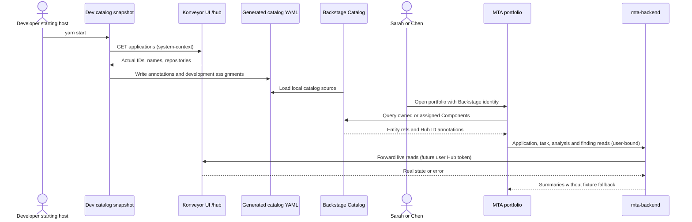
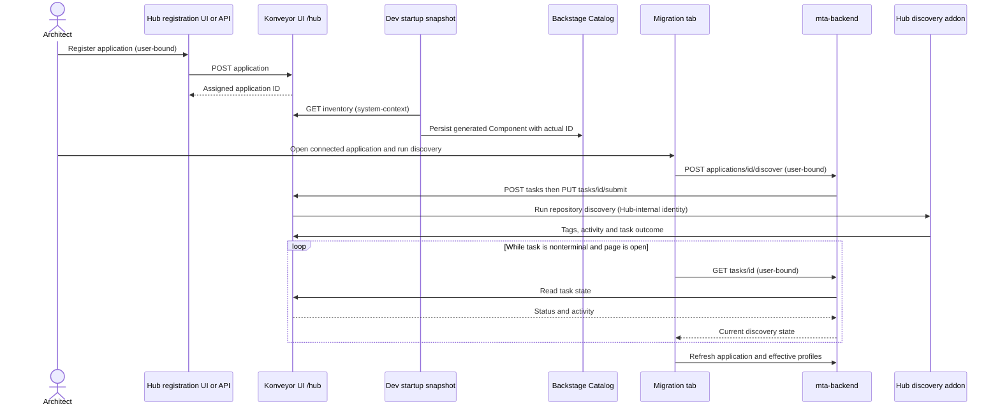
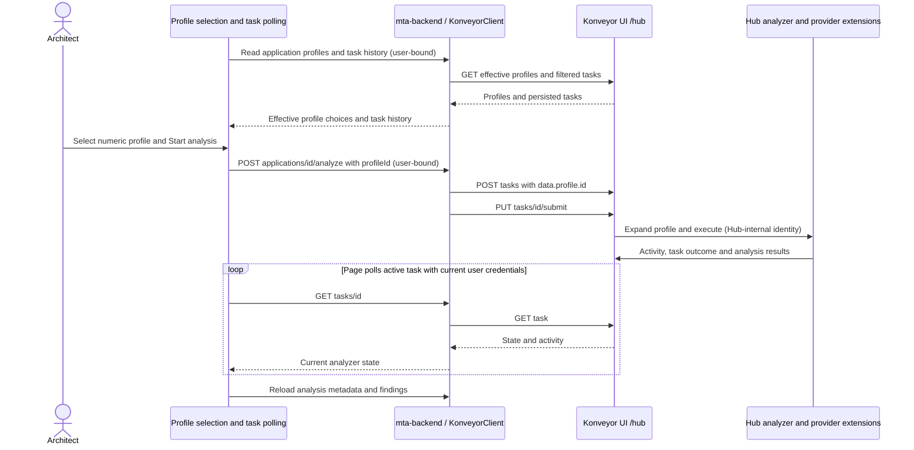
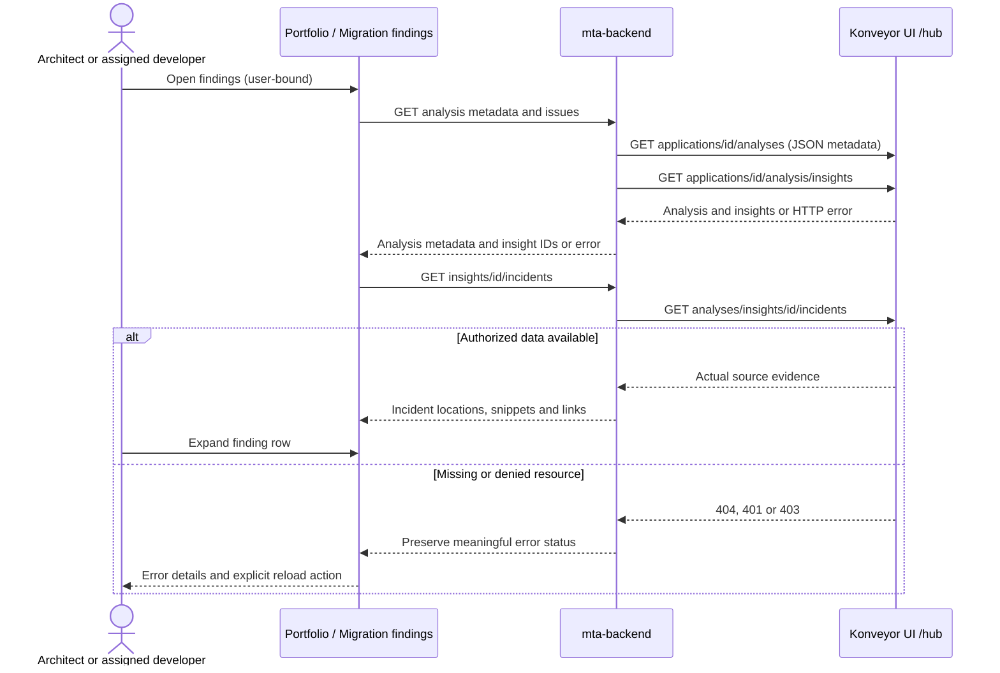

# Phase 2: live Konveyor user stories and authentication boundaries

Implementation and validation date: 2026-10-27.

## Scope

The reusable MTA frontend now reads real Hub inventory, tasks, effective analysis profiles, analyses, insights, and incidents through `mta-backend`. Connected applications can submit real discovery and analysis work. Frontend demo stores, fabricated finding counts, and simulated remediation/deployment/completion actions were removed.

The development host connects catalog entities using a read-only startup snapshot. This is not the full Phase 2a cohort loader/import/connect/reset panel and is not the Phase 4 production catalog-provider/scaffolder cutover. The existing catalog provider and `mta:register-application` scaffolder action remain mock-backed; neither implements the live flows below. Registration for these Phase 2 stories takes place in Hub, followed by catalog snapshot generation.

All Hub requests use the Konveyor UI's exposed `/hub` route. Configure `MTA_HUB_BASE_URL` with the UI origin only. Validation used `http://192.168.39.162`; no port-forward or direct Hub service connection was used. Hub authentication was disabled. Future credential classifications below are design requirements, not a claim that OIDC was implemented or verified.

## Overall story table

| Story                                                                   | Data involved                                                                                                                                | Implementing plugins / host code                                                                                                                                 | Future Hub credential boundary                                                                                                                  |
| ----------------------------------------------------------------------- | -------------------------------------------------------------------------------------------------------------------------------------------- | ---------------------------------------------------------------------------------------------------------------------------------------------------------------- | ----------------------------------------------------------------------------------------------------------------------------------------------- |
| 1. Open an accurately connected architect/developer portfolio           | Hub application IDs and names; repository URL/ref/path; catalog Component annotations, owner and assigned developer; task/analysis summaries | `dev-host/start/` (`live` scenario), `dev-host/app-config.yaml`, Backstage Catalog, `plugins/mta`, `plugins/mta-backend`; dev-auth packages supply test personas | Mixed: startup inventory read is system-context; subsequent browser-driven reads can use the individual user's Hub access token                 |
| 2. Connect registered applications and discover repository technologies | Hub application, persisted catalog application ID, discovery task ID/state/activity/errors, discovered tags                                  | Hub registration UI/API outside Backstage; development catalog snapshot; `plugins/mta` and `plugins/mta-backend` for discovery                                   | User-delegated for registration/discovery interactions; system-context for unattended snapshot; Hub owns addon execution credentials            |
| 3. Select an effective profile and run/monitor analysis                 | Matching archetype, analysis profile, target selection, analyzer task, lifecycle/events, persisted selected profile                          | `plugins/mta` (`MigrationTab`, migration/actions/polling hooks, shared lifecycle), `plugins/mta-backend` (`KonveyorClient`, routes)                              | Individual Hub token is sufficient for interactive profile reads, submit, retry, and polling; task execution is Hub-internal machine-to-machine |
| 4. Inspect findings, failures, and access/data errors                   | Analysis metadata, insights, incidents, snippets, source locations, links, task errors; HTTP statuses                                        | `plugins/mta` (findings/home hooks, `PhaseActive`, `IssueDetailPanel`, failure/error panels), `plugins/mta-backend`                                              | Individual Hub token for interactive reads; no service-account fallback on denied reads                                                         |

## Credential model used in the diagrams

- **User-bound:** a browser-initiated operation that can acquire/forward the current user's Hub OAuth access token. Backstage request authentication remains a separate credential. Catalog groups and assignments select the UI persona; they do not grant Hub privileges.
- **System-context:** work without an active browser user, such as startup inventory loading or future scheduled synchronization. Unattended operation needs a suitable machine identity/app-to-app grant. An explicitly interactive CLI login could instead use a user's token, but the current startup script does not obtain one.
- **Hub-internal:** Hub schedules addons and addons access Hub/repositories using Hub-managed task/service credentials and repository identities. Backstage does not need a long-lived user session for an already-submitted Hub job to finish.

There is no requirement for a shared Backstage-to-Hub service account merely because HTTP traffic passes through the Backstage backend. The decisive question is whether an operation has an active initiating user. Do not forward a Backstage identity token or scaffolder execution token as if it were a Hub token.

## Story 1 — Live portfolio and persona assignments

### Interaction

1. Set the UI origin and run `yarn start`, choosing the `live` scenario (or `yarn start --scenario live`).
2. The development start script (`dev-host/start/`) reads Hub applications and generates ignored `dev-host/.generated/catalog.yaml`. Components use stable `mta-application-<id>` names and actual Hub names as titles. The `live` scenario creates no Hub records or tasks.
3. `dev-host/app-config.yaml` loads that source instead of hard-coded demo Components and the mock registration template. Backstage's in-memory catalog is rebuilt from this source on restart.
4. Sarah's architect view requests owned Components. Chen's developer view requests Components carrying his assignment annotation. Unknown personas get an explicit unavailable-access view, not architect access.
5. Cards use the annotation ID to request real task/analysis state and finding rows. No name fallback or seeded status/count fallback establishes a connection.

`dev-host/data/assignments.json` (keyed by Hub application name) deliberately assigns the two validation applications to Chen. Unassigned applications still appear in the architect portfolio. Assignments are development metadata, not Hub RBAC. Snapshotting all visible Hub inventory into a shared catalog is appropriate only for this selected development environment; production metadata visibility needs an explicit policy.

### Authentication decision

Individual OIDC login can cover the interactive half. It cannot, by itself, authorize the current pre-login startup snapshot. Retain a separate read-only system integration for unattended inventory loading, or intentionally redesign import to run only under an interactive user. A future continuously scheduled catalog provider has the same system-context requirement. Writing the local YAML and reading it from the catalog needs filesystem access, not a Hub token.

### Observed validation

The initial screen incorrectly displayed the old sample names and counts against Hub application `Foo`. After the cutover, Sarah saw `Foo`, `Backstage Phase 2 Spring`, and `Backstage Phase 2 Failure`, using Hub IDs 1, 2, and 3. Chen's home showed only the two assigned validation applications, not `Foo`. Live discovery/failure changes were reflected in the portfolio without seeded counts.

## Story 2 — Connect a Hub application and run real discovery

### Interaction

1. Register the repository in Hub, including its actual branch/tag and root path. For validation, applications were created through the permitted Hub REST API; this is not a live Backstage scaffolder feature.
2. Restart development startup to snapshot the actual returned application ID into a Component. Existing connected Components retain their identity across browser reload and host restart.
3. Open the Component's Migration tab as an architect. Start discovery for a new connected application, run discovery from profile selection, or retry a failed discovery.
4. The proxy creates a `language-discovery` task, submits it, and returns the real task. The browser polls while queued/running and recovers task history when revisiting.
5. On completion, application tags and effective profiles are refreshed. A repository error is a real failed task with details and a retry action, not a timer-selected phase.

An entity without a numeric annotation shows connection instructions. An invalid annotation or missing Hub record is not automatically treated as an unregistered application and never triggers create-and-forget registration.

### Authentication decision

Interactive registration and discovery can be user-attributed Hub operations. The startup snapshot is separately system-context. Addon access to private Git/Maven repositories requires the appropriate Hub repository identity; an OIDC login to Hub does not automatically supply repository credentials. The existing mock scaffolder action remains outside this live path until Phase 4.

### Observed validation

The validation Spring application completed Hub discovery, yielding Java/Spring tags and effective profile 1. In Backstage, retrying the failure sample submitted task 9, initially displayed `Ready`, then reached `Failed`. Expanding the error panel showed the actual `git checkout` missing-branch message. No application was recreated to retry discovery.

Two environment/data issues were handled explicitly: the Minikube disk initially had no free space, and a sample commit SHA used as a branch caused the addon to attempt `git pull` on detached HEAD. The approved unused-image prune restored capacity; only the validation application was switched to the repository's default `main` branch. `Foo` and its original tasks were not overwritten.

## Story 3 — Choose a real analysis profile and monitor analysis

### Interaction

1. The tab reads effective profiles from `/applications/:id/analysis/profiles`; arbitrary archetype display names are not analyzer target identifiers.
2. Select a profile and submit its numeric ID. The backend confirms that profile is effective for the application.
3. Hub receives an analyzer task with `data.profile.id`, followed by the actual submit operation. Hub expands the profile, target choices, task templates, and provider extensions.
4. Poll `Created`, `Ready`, `Postponed`, `QuotaBlocked`, `Pending`, and `Running`; stop on terminal states. Application-filtered task history restores state after navigation/reload.
5. Refresh the persisted analysis and findings after completion. A succeeded task without persisted analysis has an explicit unavailable-results state, not a fabricated zero-findings result.
6. Retry uses the task's stored profile ID. Developers can inspect task state but do not receive architect mutation controls.

### Authentication decision

Individual Hub OIDC access tokens can authorize profile reads, submission, retry, and browser polling. Refresh tokens/session renewal must support a long-open page, and expired/denied requests must be surfaced. No Backstage machine credential is required merely to keep Hub's already-submitted analyzer running. Hub/addons still require their own internal credentials, independently of the initiating user's session.

### Observed validation

Selecting profile 1 in Backstage created task 10 with `{profile:{id:1},tagger:{enabled:true},verbosity:0}` and showed `Ready`. Its failed outcome was correctly visible to both personas. The validation profile initially omitted the selection for choice target 3; Hub reported that Spring Framework had no selection and the analyzer had no providers. The profile was corrected to `{id:3,selection:"konveyor.io/target=spring6"}`. Clicking the real Backstage retry action then created task 11, preserving the profile ID. Provider extensions were left to Hub selection rather than hard-coded in Backstage.

Task 11 subsequently reached `Succeeded` and persisted analysis 1 for commit `41f4e20bbf71fe318b11b173787aa87ba6281aec`. The tab automatically transitioned from the task view to real findings. A full browser reload followed by fresh sign-in recovered the same results without creating another application or submitting another task.

## Story 4 — Inspect genuine findings and meaningful failures

### Interaction

The frontend uses analysis metadata to distinguish absent results from a completed analysis, and then loads insights and incidents. Findings carry actual file/line, message, code snippet, links, effort, and category-derived severity. Home counts and entity rows use the same normalization. Expanding a row shows incident evidence; no AI fix availability is invented.

A successful persisted analysis with no insights says no findings, not migration complete. Deleted/missing applications, unavailable analysis, repository task failures, network errors, and denied reads have distinct error states. Incident-read failures propagate instead of silently replacing restricted evidence with an empty list.

### Authentication decision

These reads can remain entirely user-delegated. Do not retry a user's denied request with a catalog service account: that would cross the Hub authorization boundary. A background search index, cached inventory, or shared catalog summary would be a different system-context flow and would need a metadata visibility policy. UI assignment filters alone do not prevent a user from directly opening another catalog entity or calling an API; actual security must come from Backstage permissions and Hub authorization in Phase 3.

The singular Hub `/applications/:id/analysis` resource is an archive download, not JSON. Metadata reads use the plural `/analyses` list; insights/incidents use their specific JSON endpoints. This distinction was checked against the upstream handlers, not inferred from TypeScript casts.

### Observed validation

The live analysis contained 26 insight records, normalized into 48 incident-level finding rows; 17 were categorized as critical from Hub's mandatory category. Both the home summary and entity table showed the same counts. Searching for the `javax.activation` finding and expanding its row displayed actual incident 13 from `pom.xml:107`, the Hub-provided dependency replacement message, code snippet, effort, and Jakarta EE link. Chen saw the same findings without the architect's Run analysis control. Guest, whose persona is unknown, received the explicit Migration access unavailable view.

No live OIDC denial was manufactured by disabling or changing Hub auth. The real missing-branch failure was verified in the browser; missing-record/analysis and denied-incident/status behavior were covered by the focused tests.

## Verification boundaries

Repository checks passed after integration: `yarn tsc`; plugin Jest suites (18 suites, 154 tests); `yarn build:backend`, including the bundled frontend. MUI v4 `findDOMNode` deprecation warnings remain; they were not suppressed or treated as an authorization/data fix.

The browser exercised the real UI-to-proxy-to-Hub path, not a mocked Hub. Focused behavior/contract tests additionally cover queued/blocked/terminal tasks, stale responses, invalid annotations, missing analyses, incident errors, and HTTP 401/403 preservation. Because the live instance had authentication disabled, no real multi-user Hub RBAC/OIDC enforcement was verified.

A full development-host restart regenerated the same three application-ID associations, loaded the persisted analysis, and again displayed 48 findings after a fresh sign-in. Startup submitted no new Hub tasks. The original `Foo` repository configuration and its two original tasks were checked unchanged.

## Validation resources and upstream references

Created resources are intentionally left in the development Hub for inspection:

| Resource                                           | ID  | Purpose                                                                        |
| -------------------------------------------------- | --- | ------------------------------------------------------------------------------ |
| Analysis profile `Backstage Phase 2 - Spring 6`    | 1   | Spring Framework target 3 with explicit `konveyor.io/target=spring6` selection |
| Archetype `Backstage Phase 2 - Java modernization` | 2   | Java tag 404 criteria, target profile referencing analysis profile 1           |
| Application `Backstage Phase 2 Spring`             | 2   | Discovery, effective profile, analysis, findings, and reload validation        |
| Application `Backstage Phase 2 Failure`            | 3   | Actual missing-branch task failure and retry validation                        |

Both validation applications use `https://github.com/konveyor/example-applications`, path `example-1`. The failure application's branch is deliberately `backstage-phase2-missing-branch`. The pre-existing `Foo` application (ID 1) and `Archy Alpha` archetype (ID 1) were retained.

Authoritative contracts consulted:

- [Hub application models](https://github.com/konveyor/tackle2-hub/blob/main/shared/api/application.go)
- [Hub task handlers and submission](https://github.com/konveyor/tackle2-hub/blob/main/internal/api/task.go)
- [Hub analysis handlers and archive/JSON routes](https://github.com/konveyor/tackle2-hub/blob/main/internal/api/analysis.go)
- [Hub analysis profile model](https://github.com/konveyor/tackle2-hub/blob/main/shared/api/analysis.go)
- [Hub archetype and target-profile model](https://github.com/konveyor/tackle2-hub/blob/main/shared/api/archetype.go)
- [Upstream UI profile-based analysis payload](https://github.com/konveyor/tackle2-ui/blob/main/client/src/app/pages/applications/analysis-wizard/useTaskGroupManager.ts)
- [Hub OIDC and internal task/service authentication](https://github.com/konveyor/tackle2-hub/blob/main/internal/auth/README.md)
